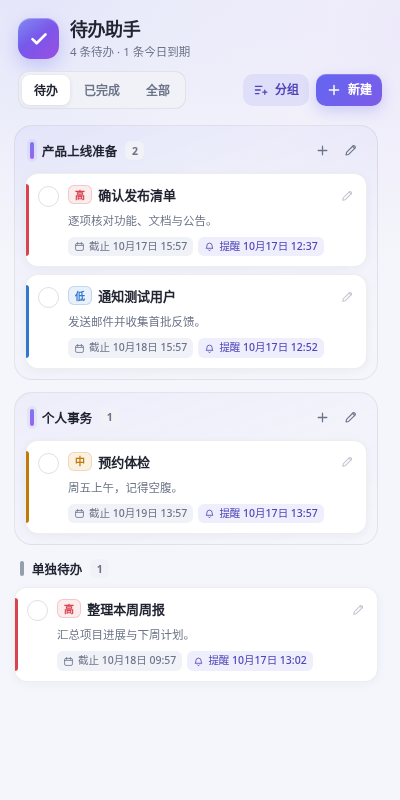
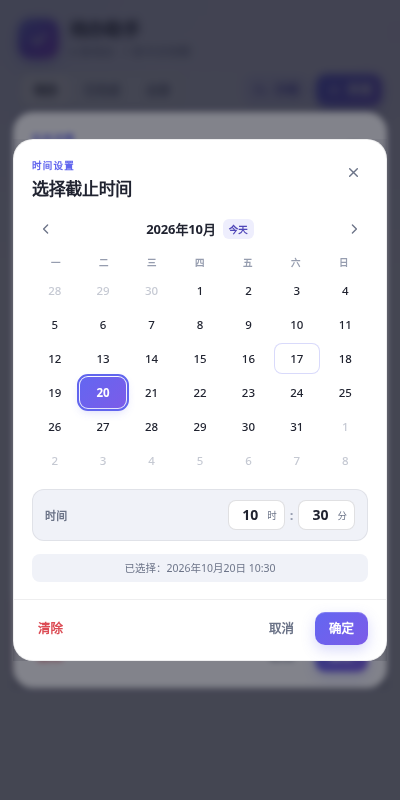

# 待办助手

一个运行在浏览器侧栏中的轻量待办扩展，兼容 **Microsoft Edge** 与 **Google Chrome**。基于 Manifest V3，使用原生 HTML / CSS / JavaScript 编写，无需构建、无第三方依赖、无后端服务。

<p align="center">
  
  
</p>

## 功能

- 点击工具栏图标，在浏览器侧栏中管理待办。
- 支持新建单条待办，或创建包含多条待办的自定义命名分组。
- 每条待办支持名称、备注、截止时间和提醒时间。
- 使用完全内嵌于侧栏的日期时间选择器，不受原生日期弹窗被侧栏裁切的影响。
- 到达提醒时间后发送系统通知；错过的提醒会在下次启动浏览器后补发。
- 四档优先级（高 / 中 / 低 / 普通），以彩色标签和卡片侧边色条区分。
- 支持完成、取消完成、编辑、删除，以及按“待办 / 已完成 / 全部”筛选。
- 工具栏图标显示未完成数量角标。
- 数据保存在浏览器本地，多个侧栏实例之间自动同步。
- 支持浅色与深色模式、窄侧栏布局。

## 兼容性

- Microsoft Edge 114+
- Google Chrome 114+
- 已使用 Edge 155 实际加载验证，包括侧栏打开、创建与编辑、提醒通知、闹钟调度和自定义时间选择器。

侧栏功能基于 Chromium 的 [`chrome.sidePanel`](https://developer.chrome.com/docs/extensions/reference/api/sidePanel) API。

## 安装

### 从源码加载

```bash
git clone git@github.com:ktmitax/BrowserTodoHelper.git
cd BrowserTodoHelper
```

然后在浏览器中加载扩展目录：

**Microsoft Edge**

1. 打开 `edge://extensions/`。
2. 开启“开发人员模式”。
3. 点击“加载解压缩的扩展”，选择项目目录。
4. 将“待办助手”固定到工具栏，点击图标打开侧栏。

**Google Chrome**

1. 打开 `chrome://extensions/`。
2. 开启“开发者模式”。
3. 点击“加载已解压的扩展程序”，选择项目目录。
4. 将“待办助手”固定到工具栏，点击图标打开侧栏。

## 使用说明

- 点击工具栏图标打开侧栏。
- **新建**：创建单条待办，可设置所属分组、截止时间、提醒时间和优先级。
- **分组**：一次创建多条同组待办；分组标题右侧的 `+` 可继续添加待办，铅笔图标可重命名或删除分组。
- 点击日期时间字段会打开侧栏内的选择弹窗，支持月份切换、选择日期、手动输入小时和分钟，以及清除时间。
- 截止时间用于展示、排序和逾期提示；提醒时间用于发送系统通知，两者相互独立。
- 删除分组会同时删除该分组内的所有待办，操作前会进行二次确认。
- 点击系统通知会尝试打开扩展侧栏；提醒时间已被处理的通知不会重复发送。

> 若没有看到系统通知，请检查操作系统的通知权限，以及浏览器是否允许扩展发送通知。

## 数据与隐私

- 所有待办、分组和提醒状态仅保存在浏览器扩展的本地存储 `chrome.storage.local` 中。
- 扩展不发起网络请求，不收集、不传输任何用户数据。
- 卸载扩展会清除本地数据。
- 数据不会在多台设备之间同步。

## 权限说明

| 权限            | 用途                             |
| --------------- | -------------------------------- |
| `storage`       | 本地保存待办、分组和提醒状态     |
| `alarms`        | 在设定时间唤醒扩展并执行提醒     |
| `notifications` | 显示系统通知                     |
| `sidePanel`     | 在浏览器侧栏中展示扩展界面       |

## 项目结构

```text
.
├── manifest.json                  # Manifest V3 扩展清单
├── background.js                  # 提醒调度、通知、角标与侧栏行为
├── sidepanel.html                 # 侧栏页面结构
├── sidepanel.css                  # 侧栏样式（含深色模式）
├── sidepanel.js                   # 交互、状态管理与日期时间选择器
├── icons/                         # 扩展图标
├── docs/                          # README 展示截图
└── README.md
```

## 本地开发

项目没有构建步骤，修改文件后按以下方式生效：

1. 在 `edge://extensions/` 或 `chrome://extensions/` 中点击扩展卡片上的“重新加载”。
2. 关闭并重新打开侧栏，以载入新的 HTML / JavaScript。

### 实现要点

- `chrome.sidePanel.setPanelBehavior({ openPanelOnActionClick: true })` 让点击工具栏图标直接打开侧栏。
- 提醒通过 `chrome.alarms` 持久化调度，服务线程休眠或浏览器重启后仍会重新同步。
- `background.js` 监听本地存储变化，自动同步闹钟、通知状态和图标角标。
- 界面使用原生 DOM API 构建，无框架和运行时依赖。
- 原生日期输入替换为自定义侧栏内日期时间选择器，确保在窄侧栏中完整显示。
